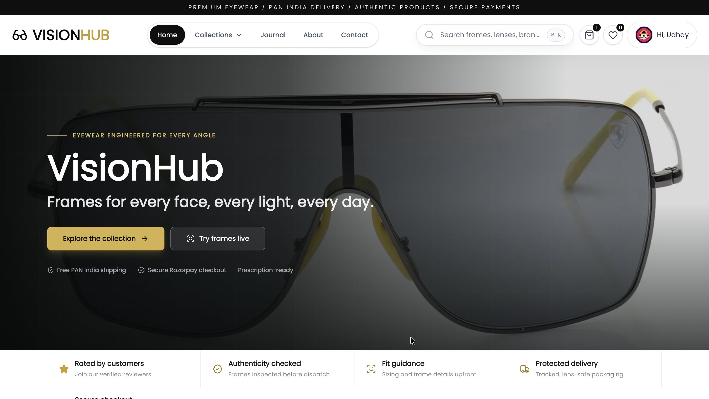

# 👓 VisionHub

A full-stack eyewear commerce platform built with Next.js 16, React 19, TypeScript, Sanity, Clerk, Razorpay, Resend, and Tailwind CSS 4.


---

## 🚀 Live Demo

[https://visionhub.vercel.app](https://visionhub.vercel.app)

---

## 📖 About The Project

VisionHub is a premium eyewear e-commerce platform for discovering, comparing, virtually trying on, and purchasing sunglasses, computer glasses, prescription frames, premium optical, and sports eyewear.

The customer experience includes a searchable product catalog with detailed specifications, category and brand discovery, a camera-based virtual try-on, persistent cart and wishlist state, coupon-aware Razorpay checkout, order tracking, cancellation requests, invoices, refund credits, moderated reviews, notifications, newsletters, and full account management.

The operations side includes an authenticated admin workspace for catalog management, inventory, orders, customers, access requests, coupons, reviews, content, subscriptions, contacts, notifications, and business analytics. Sanity Studio is embedded directly in the application at `/studio`.

---

## ✨ Features

### 🛍 Customer Features

- Eyewear catalog with search, category, brand, price, and sorting controls
- Product pages with image galleries, stock status, discounts, specifications, ratings, and related products
- Premium hero section with dynamic Sanity imagery, trust strip, and Framer Motion micro-interactions
- Category, brand, deal, blog, FAQ, help, contact, privacy, and terms pages
- AI Stylist beta with live camera try-on, MediaPipe face tracking, automatic frame fitting, and manual fit controls
- Persistent shopping cart and wishlist, recently viewed products, and a browser-local My Looks gallery
- Coupon validation and an additional 2% discount for approved business accounts
- Secure Razorpay checkout with cards, UPI, wallets, and netbanking
- Customer dashboard with order statistics, recent activity, saved items, and wallet balance
- Profile, address, preference, notification, premium account, and business account management
- Paginated order history, order detail pages, status timelines, cancellation requests, and invoices
- Wallet balance and transaction models for eligible refund credits
- Moderated product reviews, rating summaries, verified-purchase checks, and helpful votes
- Transactional emails, in-app notifications, newsletter subscription, and contact support
- Responsive layouts, loading skeletons, mobile navigation, testimonial carousel, and custom error pages

### 💳 Payment Features

- Razorpay order creation and hosted payment checkout
- Server-side cart, price, coupon, business discount, tax, shipping, and stock validation
- Razorpay signature verification and webhook processing
- Payment success and failure flows with automatic stock reduction
- Cancellation handling and wallet refund tracking
- Resend-powered order confirmation and order status emails

### 🔐 Authentication

- Clerk sign-in and registration
- Protected customer, cart, wishlist, checkout, settings, and admin routes
- Clerk and Sanity user profile integration
- Email-based admin allowlist through `NEXT_PUBLIC_ADMIN_EMAIL`
- Premium and business account application and approval workflows
- Role and permission models for call center, packing, warehouse, delivery, in-charge, and accounts employees

### ⚙️ Admin Features

- Revenue, order, customer, product, inventory, and activity dashboards
- Product CRUD, image uploads, stock control, discounts, featured items, and drag-to-reorder display order
- Category, brand, banner, blog, and coupon management
- Order search, filtering, status updates, cancellation processing, refunds, invoices, and email resending
- Review moderation and rating administration
- Clerk and Sanity user management, synchronization, account activation, and access approvals
- Premium and business account request management
- Employee role, permission, status, and performance data management
- Newsletter subscriber and contact request management
- Targeted and bulk notification management
- Embedded Sanity Studio and GROQ Vision at `/studio`

### 🎯 SEO & Performance

- App Router metadata, canonical URLs, Open Graph, and Twitter card configuration
- Dynamic sitemap and robots configuration
- Product, organization, website, category, and breadcrumb JSON-LD
- Sanity image optimization through `next/image`
- Server rendering, Suspense boundaries, route-level skeletons, and responsive loading states
- Tagged Next.js caching with targeted path revalidation
- Sanity-backed business analytics and internal best-seller tracking
- Scroll-reveal animations via Framer Motion with optimized viewport margins

---

## 🛠 Tech Stack

### Frontend

- Next.js 16 App Router
- React 19
- TypeScript 5
- Tailwind CSS 4
- Radix UI and shadcn-style components
- Framer Motion and Motion
- Lucide React and React Icons
- Zustand with persisted cart and wishlist state
- Recharts
- MediaPipe Face Mesh for virtual frame fitting

### Backend

- Next.js Route Handlers
- React Server Components
- Server Actions
- Sanity GROQ queries and mutations
- Next.js cache tags and path revalidation
- Resend email delivery

### Database & CMS

- Sanity 4
- Embedded Sanity Studio
- Schemas for products, categories, brands, banners, blogs, coupons, orders, users, addresses, reviews, contacts, subscriptions, notifications, and access requests

### Authentication

- Clerk
- Clerk server middleware and admin email authorization

### Payments

- Razorpay storefront checkout, signature verification, and webhook processing

### Deployment

- Vercel

---

## 📂 Project Structure

```bash
VisionHub
├── app
│   ├── (admin)           # Protected admin workspace
│   ├── (auth)            # Clerk sign-in and sign-up pages
│   ├── (client)          # Storefront, account, cart, and checkout routes
│   ├── api               # Commerce, account, admin, analytics, and payment APIs
│   ├── invoice           # Printable order invoices
│   └── studio            # Embedded Sanity Studio
│
├── actions               # User, order, review, employee, wallet, and wishlist actions
├── components            # Shared and domain-specific React components
│   ├── admin             # Admin dashboards and resource managers
│   ├── cart              # Cart, address, and checkout controls
│   ├── checkout          # Razorpay checkout experience
│   ├── common            # Shared presentational components (Logo, SearchBar, SocialMedia, ImageView)
│   ├── invoice           # Invoice components
│   ├── layout            # Navigation, mobile menu, sidebar, and footer
│   ├── product           # Product detail and catalog components
│   ├── profile           # Customer profile and account controls
│   ├── shopPage          # Shop filters and product listing
│   └── ui                # Reusable Radix-based UI primitives
│
├── config                # Contact and application configuration
├── constants             # Navigation, footer links, FAQ data
├── contexts              # Shared customer data context
├── docs                  # Feature, setup, architecture, SEO, and caching guides
├── hooks                 # Shared React hooks
├── images                # Local storefront image assets
├── lib                   # Checkout, email, SEO, caching, and shared utilities
├── public                # Public logo and preview assets
├── sanity                # Clients, queries, schemas, images, and Studio structure
├── scripts               # Maintenance and diagnostic scripts
├── tests                 # Reward and loyalty point tests
├── types                 # Employee and review types
├── proxy.ts              # Clerk route protection
└── store.ts              # Persisted Zustand cart and favorites store
```

---

## ⚡ Installation

Clone the repository:

```bash
git clone https://github.com/udhaybhat00/visionhub.git
```

Move into the project:

```bash
cd visionhub
```

Install dependencies:

```bash
npm ci
```

Create `.env.local` from the environment variable reference below, then run the development server:

```bash
npm run dev
```

Open [http://localhost:3000](http://localhost:3000). Sanity Studio is available at [http://localhost:3000/studio](http://localhost:3000/studio).

Generate Sanity schema types after changing a schema:

```bash
npm run typegen
```

Check the project:

```bash
npm run lint
npm run build
```

Start the production build:

```bash
npm start
```

---

## 🔑 Environment Variables

Create a `.env.local` file. The following variables cover the integrations used by the project:

```env
# Application
NEXT_PUBLIC_BASE_URL=http://localhost:3000
TAX_AMOUNT=0

# Clerk
NEXT_PUBLIC_CLERK_PUBLISHABLE_KEY=
CLERK_SECRET_KEY=

# Sanity
NEXT_PUBLIC_SANITY_PROJECT_ID=
NEXT_PUBLIC_SANITY_DATASET=production
NEXT_PUBLIC_SANITY_API_VERSION=2024-11-09
SANITY_API_TOKEN=
SANITY_API_READ_TOKEN=

# Razorpay - active checkout
NEXT_PUBLIC_RAZORPAY_KEY_ID=
RAZORPAY_KEY_SECRET=
RAZORPAY_WEBHOOK_SECRET=

# Email
RESEND_API_KEY=
RESEND_FROM_EMAIL=
# SENDER_EMAIL_ADDRESS= # Alternative sender variable

# Admin access - comma-separated email addresses
NEXT_PUBLIC_ADMIN_EMAIL=

# Optional reward configuration
REWARD_POINTS_THRESHOLD=3000
REWARD_POINTS_AMOUNT=5
LOYALTY_POINTS_ORDER_THRESHOLD=5
LOYALTY_POINTS_AMOUNT=100

# Optional company and contact configuration
NEXT_PUBLIC_COMPANY_NAME=VisionHub
NEXT_PUBLIC_COMPANY_EMAIL=
NEXT_PUBLIC_COMPANY_PHONE=
NEXT_PUBLIC_COMPANY_ADDRESS=
NEXT_PUBLIC_COMPANY_CITY=
NEXT_PUBLIC_COMPANY_DESCRIPTION=
NEXT_PUBLIC_COMPANY_BUSINESS_HOURS_WEEKDAY=
NEXT_PUBLIC_COMPANY_BUSINESS_HOURS_WEEKEND=
NEXT_PUBLIC_SUPPORT_EMAIL=
NEXT_PUBLIC_SALES_EMAIL=
NEXT_PUBLIC_CONTACT_RESPONSE_TIME=
NEXT_PUBLIC_QUICK_RESPONSE_TIME=
NEXT_PUBLIC_INSTAGRAM_URL=
NEXT_PUBLIC_FACEBOOK_URL=
NEXT_PUBLIC_YOUTUBE_URL=
NEXT_PUBLIC_COPYRIGHT_TEXT=
NEXT_PUBLIC_PRIVACY_POLICY_URL=/privacy
NEXT_PUBLIC_TERMS_URL=/terms

```

Use a Sanity token with write permissions for admin mutations and server-side order processing. Configure the Razorpay webhook endpoint as `/api/razorpay/webhook`, and use a verified sender domain for production email delivery.

---

## 📸 Screenshots



Recommended additional screenshots:

- Product catalog and product detail
- AI Stylist live virtual try-on
- Cart and Razorpay checkout
- Customer dashboard and order timeline
- Admin dashboard and analytics
- Admin product and order management

---

## 👨‍💻 Developer

### Udhay Bhat

👨‍💻 Self-Taught Full Stack Developer

🔐 Cybersecurity Enthusiast

🛠 Kali Linux & Security Testing

📊 Machine Learning Projects

📚 Learning Deep Learning & Neural Networks

💻 Passionate About Building Real-World Software Solutions

---

## 🛠 Skills

### Languages

- C
- Java
- Python
- JavaScript
- TypeScript

### Frontend

- HTML5
- CSS3
- React.js
- Next.js
- Tailwind CSS
- Responsive UI

### Cloud & Hosting

- Vercel
- Sanity
- Netlify
- GitHub Pages

### Tools

- Git
- GitHub
- VS Code
- Postman
- Sanity Studio
- Clerk

### Operating Systems

- Kali Linux
- Ubuntu
- Linux
- Windows
- macOS

---

## 📈 Future Improvements

- Complete the AI Stylist save flow and move looks from local storage to authenticated cloud profiles
- Improve virtual try-on accuracy, frame masking, accessibility, and device compatibility
- Add automated end-to-end coverage for checkout, payments, cancellations, and admin workflows
- Add inventory forecasting and low-stock alert automation
- Add PWA support and offline-friendly browsing
- Build companion mobile applications

---

## 🤝 Connect With Me

GitHub: https://github.com/udhaybhat00

LinkedIn: Add Your LinkedIn Profile

Portfolio: Add Your Portfolio Link

---

## ⭐ Support

If you found this project useful, please consider giving it a star.

---

<div align="center">

### VisionHub

Modern Eyewear E-Commerce Platform

Built with ❤️ by Udhay Bhat

</div>
